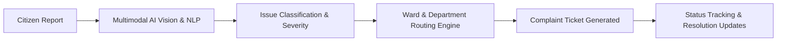

# CivicFix AI 🏛️⚡

> **AI-Powered Civic Issue Reporting Agent** with automated image analysis, ward and department routing, mock complaint filing, and real-time ticket status tracking.

---

## 🌟 Overview

**CivicFix AI** simplifies civic issue reporting for citizens and municipal authorities. By leveraging multimodal AI and intelligent routing, CivicFix transforms unstructured citizen reports (photos, descriptions, location coordinates) into structured, prioritized civic service requests routed directly to the correct department.

---

## ✨ Key Features

- 📸 **Multimodal Image Analysis**: Uses computer vision to analyze photos of civic issues (potholes, garbage accumulation, broken streetlights, water leaks, etc.), estimating issue severity and generating descriptive incident summaries.
- 📍 **Ward & Authority Mapping**: Maps geographic coordinates and addresses to administrative zones, wards, and municipal boundaries.
- 🏛️ **Intelligent Department Routing**: Automatically determines the responsible department (e.g., Roads & Infrastructure, Solid Waste Management, Water Supply & Sewerage, Electrical/Street Lighting).
- 🎫 **Automated Complaint Filing**: Generates standardized complaint tickets with unique tracking IDs, priority classifications, and actionable metadata.
- 📊 **Ticket Status Tracking**: Provides transparent lifecycle tracking from submission, triage, department dispatch, in-progress work, to resolution verification.

---

## 🏗️ Architecture & Workflow



---

## 🚀 Getting Started

### Prerequisites

- Node.js (v18+) or Python (3.10+) depending on services
- Git

### Installation

```bash
# Clone the repository
git clone https://github.com/PrabhdeepCodeZone/civicfix-ai.git

# Navigate into the project directory
cd civicfix-ai
```

---

## 🗺️ Roadmap

- [x] Initial repository setup & specification
- [ ] Multimodal vision analysis pipeline for issue detection
- [ ] Municipal ward & GIS mapping integration
- [ ] Automated department triage and mock filing engine
- [ ] Citizen dashboard & real-time ticket tracking interface
- [ ] Push notifications & SMS status alerts

---

## 🤝 Contributing

Contributions, issues, and feature requests are welcome! Feel free to check the issues page or submit a pull request.

---

## 📄 License

This project is licensed under the MIT License.
